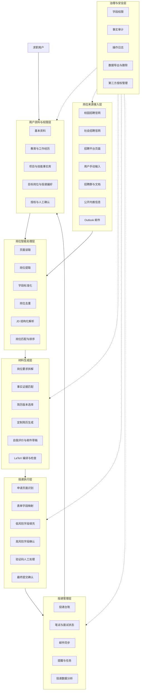

# CareerOS 求职投递工作台：产品总架构与分期总览

## 1. 产品定义

CareerOS 是面向个人求职者的 AI 岗位分析、简历适配与投递辅助工作台。用户提供校园招聘官网、社会招聘官网或招聘平台页面，在浏览器中登录自己的求职账号，系统读取用户主动打开或授权的岗位页面，完成岗位解析、匹配分析、材料生成和投递记录。

产品解决的是岗位信息分散、JD 判断成本高、简历反复修改、申请表重复填写和投递状态难追踪的问题。

## 2. 核心用户流程

```text
创建用户资料与事实库
→ 提供招聘官网链接
→ 用户在浏览器中登录自己的账号
→ 读取岗位列表与岗位详情
→ 解析 JD
→ 匹配用户资料与真实经历
→ 生成岗位定制简历
→ 编译 PDF 并进行质量检查
→ 辅助填写申请表
→ 用户处理验证码、高风险字段和最终提交
→ 保存投递记录并跟踪后续状态
```

## 3. 全量产品架构



## 4. 分期视觉语言

总架构图使用黑白中性样式，表达长期稳定的产品骨架。分期图在总架构之上叠加不同颜色，表示新增模块和新增能力。

| 阶段 | 视觉语言 | 产品含义 | 主要目标 |
|---|---|---|---|
| 一期 | 黑色实线、白色背景 | 核心基础能力和人工确认节点 | 完成一次可靠投递 |
| 二期 | 浅蓝色模块和连接线 | 多网站、批量处理和效率能力 | 降低重复操作成本 |
| 三期 | 浅绿色模块和连接线 | 外部信息扩展和智能策略 | 扩大岗位来源并形成个性化策略 |

颜色只区分阶段，不改变核心数据对象、页面入口和模块接口。

## 5. 长期稳定的数据对象

```text
UserProfile：用户资料
EvidenceItem：经历和事实证据
SiteConnection：招聘网站连接
JobPosting：岗位信息
JDAnalysis：JD 解析结果
MatchResult：岗位匹配结果
ResumeVariant：岗位定制简历
Application：投递申请
Communication：邮件与沟通记录
ReferralLead：内推信息候选
AuditEvent：操作审计记录
```

## 6. 全量模块编号

一期模块使用 `M01-M16`，二期使用 `M17-M22`，三期使用 `M23-M28`。模块编号一旦确定，后续不因页面改版或实现方式变化而重新编号。

详细模块定义见 [全量功能模块与优先级](02_全量功能模块与优先级.md)。

## 7. 产品边界

产品使用浏览器中用户本人已经建立的登录会话，读取用户主动打开或授权的页面；系统不保存招聘网站密码，不读取手机验证码，不绕过滑块验证，也不未经用户确认完成最终提交。

小红书内推信息、招聘群消息和文档导入放在三期，作为补充来源。官网和正式投递入口仍然是申请流程的主来源。
