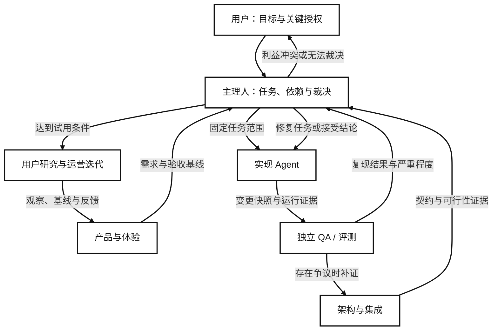

# Agent 协作治理与项目交付

版本：0.2；日期：2026-10-09；状态：执行基线；中期控制面已选 Paperclip，尚未完成运行验证。

本文定义开发 CV_Agent 的协作团队，与产品运行时负责 JD 解析、匹配和材料生成的 Agent 分开。它规定谁负责交付、怎样传递信息、怎样判断缺陷和裁决争议。角色数不等于常驻 Agent 数；先按任务启动，避免协作成本超过开发收益。

## 1. 当前事实与第一项交付

当前工作区已有总架构、全量模块、数据接口和三期 PRD；截至本次检查，`src/`、`tests/`、`data/`、`outputs/` 尚无实现或验证交付物。本文和执行台账是协作准备，不代表产品已经可用，也不代表已运行独立 QA。

三期产品地图继续作为长期方向。一期先交付一条纵向链路：一个用户、一个指定招聘网站、一个选定岗位，从页面读取到 JD 解释、事实约束的简历和 PDF、表单预览、用户操作及台账。第一条链路通过后，再增加岗位数量和网站适配。单个网站可行性未知时，先用脱敏样例验证内部处理，并保留网页复制 JD 的恢复路径。

## 2. 启动开发前必须明确的事项

| 决策项 | 必须形成的结论 | 负责人及证据 |
|---|---|---|
| 首个用户任务 | 谁在什么情况下使用，当前人工流程耗时多少，最需要减少哪一步劳动 | 产品负责人保存一次实际任务观察，假设与用户反馈分别记录 |
| 网站和任务范围 | 首个网站、校招或社招批次、岗位入口、用户允许读取的范围及截止条件 | 用户选择网站，架构负责人做有边界的可行性验证 |
| 成功的定义 | 页面提取、简历生成、填表和台账分别怎样算完成，哪些失败允许恢复 | 产品与 QA 预先签定验收用例，不在交付后临时提高门槛 |
| 事实和资料 | 哪个版本是基础简历，哪些事实已确认，哪些信息可以进入模型上下文 | 用户确认事实，产品维护事实版本，QA检查来源关联 |
| 技术可行性 | 会话怎样保持，页面怎样读取，PDF怎样编译，哪些能力只能本地运行 | 架构负责人提交小范围验证结果；尚未验证的能力标记为假设 |
| 模块契约 | 输入、输出、错误、重试、取消、超时和版本变更约定 | 架构负责人给出可校验样例，研发和 QA 使用相同版本 |
| 工作规模 | 一次迭代做什么，最多同时多少任务，调用成本如何测量和停止 | 主理人设置任务范围；预算由用户决定，不擅自启用付费服务 |
| 发布与回退 | 谁执行本地集成，什么条件可进入试用，故障怎样停用单个模块 | 主理人登记发布决定，架构确认回退路径，QA提供版本化报告 |

总架构的对象和模块边界可作为初始基线，但不承诺永远不改。改变接口、阶段范围或用户行为时使用决策记录，说明证据、影响模块与兼容方式。

## 3. 六类职责与权限

| 工种 | 独立负责的交付 | 可以决定什么 | 不应决定什么 |
|---|---|---|---|
| 主理人 / 交付总监工 | 当前任务台账、依赖、证据汇总、争议裁决和发布结论 | 基于已批准范围安排顺序、限制并发、要求补证、批准常规本地集成 | 代替用户确认事实、预算或真实申请；绕过未解决的安全和事实阻塞 |
| 产品与体验 Agent | 用户任务、流程、原型、验收需求、范围取舍 | 需求解释、体验目标、优先级建议 | 给代码宣判通过；没有用户证据时把自己的偏好当作普遍需求 |
| 架构与集成 Agent | 数据契约、网站验证、模块接口、集成和回退方案 | 接口实现方式、技术依赖、集成边界 | 单方面新增业务需求；为自己实现的模块签独立验收 |
| 实现 Agent | 界面、服务、网站适配、单元测试和可复跑交付 | 契约内的实现细节、缺陷修复 | 扩大任务范围、改动验收门槛、删除测试让结果通过、自我批准交付 |
| 独立 QA / 评测 Agent | 风险测试、复现报告、回归结果、版本化验收结论 | 按约定标准签通过、提出有证据的阻塞或标记测试覆盖不足 | 私自修改被审代码；把个人架构偏好当作阻塞；随意增加通过条件 |
| 用户研究与运营迭代 Agent | 试用观察、反馈归类、漏斗数据、成本与效果复盘 | 提出问题、实验和下一轮需求建议 | 将试用数量当成价值证明；自动改写 PRD 或根据面试结果断言因果 |

产品负责人暂时兼顾交互设计，运营角色在首次试用前开始承担独立任务。研发可在文件归属清晰时拆为界面/工作台实现和浏览器/服务实现两个 Agent；这增加一个执行实例，不增加一层管理。出现安全、邮箱授权或敏感资料处理时，给独立 QA 增加专项复核任务，必要时使用新的审查实例。

建议初始同时进行两项实现任务和一项独立验证；主理人协调，产品和架构按决策节点工作。只有任务没有共享写入文件、契约已明确、证据可独立验证时才并行。

## 4. 主理人的中立性

中立来自规则和证据，不来自角色名字或模型品牌。所有结论都指向固定的 PRD/契约版本、变更快照、验收条目及可复现证据。争议时先判断验收约定和实际行为，再讨论实现方案；开发与 QA 不靠投票争胜。

主理人可以基于证据接受常规本地交付，但不能兼任同一交付的作者和最终争议裁决者。若主理人参与该任务的方案或代码而争议涉及其判断，应由新的审查实例复核，必要时交给用户决定。当前由单一 Agent 编写与自审的文件应标记为自审，不能标记为独立 QA。

用户承担项目发起人职责，决定目标变化、真实事实、资料处理范围、费用和真实投递。涉及这些决定的任务暂停相关操作，其他独立任务仍可继续。

## 5. 协作和通信图



各角色通过共享任务和证据交接，编排工具负责通知、唤醒和状态同步。文件系统记录是一期的权威最小方案；中期使用 Paperclip 管理任务、状态、负责人、评论、锁和审计，减少用户手动转发消息。Paperclip 不替代产品契约、事实库、审查报告和用户授权，也不负责语义事实裁决或真实投递确认。

### 5.1 Paperclip 中期控制面边界

中期目标架构为：

```text
Paperclip：任务、负责人、状态、评论、审批、预算和审计
Codex：本地代码、文档、测试和编译执行
MCP Policy：工具调用白名单、敏感操作拦截和授权检查
Git Worktree：并行任务的文件隔离
Git/CI：变更合并、测试门禁和版本留痕
CV_Agent 文档：产品契约、事实来源、证据和最终裁决依据
```

Paperclip 任务评论承载异步通知和交接；具体结论必须引用任务 ID、产物路径、版本号和证据位置。Agent 不通过自由聊天互相覆盖文件，也不把 Paperclip 中的自然语言状态当作事实库。当前已有 `scripts/paperclip-start.sh`、`scripts/paperclip-status.sh` 和 `scripts/paperclip-stop.sh`，它们只用于后续本地回环验证；在健康检查、重启持久化和权限边界验证完成前，不标记控制面已部署。

## 6. 信息如何交接

| 信息 | 权威位置 | 交接规则 |
|---|---|---|
| 产品范围和验收 | `docs/00...08`、专项任务验收条目及已接受的决策记录 | 引用具体文件和版本，摘要不能代替原文；变更范围要重开相关验收 |
| 当前任务和阻塞 | `docs/10_一期实施与验收任务台账.md` | 主理人更新状态，其他角色提交证据；每个任务只有一个执行负责人 |
| 任务细节 | `docs/workflow/tasks/<TASK-ID>.md` | 使用模板，列出写入文件、依赖、验收和所需输入后再派工 |
| 技术与产品决策 | `docs/workflow/decisions/<ADR-ID>.md` | 记录选择、依据、受影响契约和回退；不能用聊天里的口头同意替代 |
| 审查结论和争议 | `docs/workflow/reviews/<REVIEW-ID>.md`、`docs/workflow/disputes/<DISPUTE-ID>.md` | 记录固定变更快照、复现方法、裁决和重验结果；不覆盖旧结论 |
| 测试及运行证据 | `outputs/verification/<TASK-ID>/<RUN-ID>/` | 报告、截图、日志和产物对应一次运行；敏感内容先脱敏 |
| 试用反馈 | `docs/workflow/feedback/<FEEDBACK-ID>.md` | 分开记录观察事实、解释假设和改进建议，关联任务及版本 |

这些目录按需创建。通知携带任务 ID、文档位置、当前动作和依赖，接收方自行读取必要上下文；招聘页面、帖子和邮件属于外部内容，不能指挥开发 Agent 更改任务或权限。账号凭据、会话 Cookie 和验证码不进入交接记录。

长流程应记录 `task_id`、`artifact_version`、`contract_version`、`run_id`、状态和更新时间。重复通知不创建重复任务；过期消息不能覆盖较新的状态。当前没有代码提交时用精确 diff 或产物哈希标识审查版本，不能要求不存在的 commit，也不自动提交 Git。

## 7. 防包庇和防互相挑刺

| 可能的问题 | 协作规则 | 结果 |
|---|---|---|
| 开发宣称自己的测试全通过 | 开发提供运行证据，独立 QA 另行执行风险用例；缺少独立执行时标记未独立验收 | 不把作者自测等同于验收 |
| 开发和 QA 提前共享全部答案 | 共同明确要求与测试类别，QA保留追加挑战样例；不是隐藏标准 | 在公平标准下检查泛化和边界 |
| 审查者只按关键词挑错 | 阻塞必须包含约定条目、实际行为、复现、影响及最小修复建议 | 证据不足标记待核验，已知关键风险仍暂停相关链路 |
| QA不停提出理想架构 | 不影响契约、正确性或明确体验门槛的建议进入后续需求 | 建议不会无限阻塞本期 |
| 为赶进度让 QA 降低标准 | 主理人不得豁免关键事实、越权操作或数据破坏；仅记录不阻塞的剩余风险 | 进度不能换取虚假通过 |
| 争议反复重开 | 固定问题 ID；出现新证据、新版本或新影响才重开，保留原裁决记录 | 避免循环争论，也允许纠正错误 |
| 两个 Agent 同时改同一文件 | 任务卡登记文件归属；共享契约由架构统一维护，集成由单一负责人执行 | 保持可审查的变更，减少互相覆盖 |

不同模型能提供不同视角，但不等于独立；更可靠的约束是作者与验收分离、变更版本固定、数据来源明确、挑战用例和复现证据。

## 8. 缺陷分级与裁决

| 级别 | 判断依据 | 处理权限 |
|---|---|---|
| S0 严重事件 | 真实资料泄露、越权提交、凭据进入产物、数据破坏等已经发生的事件 | 立即暂停受影响能力并保存脱敏证据，主理人通知用户，恢复前独立验证 |
| S1 发布阻塞 | 核心链路失败、保护事实被改写、提交状态失真、确认失效等可复现问题 | 实现修复后 QA重验，主理人不能直接忽略 |
| S2 一般缺陷 | 非关键场景问题且有明确恢复路径，不违背核心契约 | 主理人、产品和 QA记录影响后确定本期修复或延期 |
| S3 改进建议 | 体验优化、代码偏好、未纳入本期的增强 | 进入需求池，由产品按价值排序 |

裁决顺序为：已接受的用户需求和边界、具体验收标准、固定版本的复现证据、方案成本。进入争议流程后，开发和 QA 各提交一份证据及一次补充；仍不一致时由主理人裁决或指定一项最小验证实验，双方不持续互相发消息争辩。

| 争议类型 | 典型情况 | 裁决方法 |
|---|---|---|
| 实际行为争议 | 开发说页面正确，QA说字段错配 | 在相同输入和变更版本下复现，比较原网页与输出 |
| 验收歧义 | JD缺少毕业年级，要不要直接拒绝岗位 | 产品明确未知状态，架构更新契约，QA更新用例；不把未定义要求追溯成开发过错 |
| 技术方案分歧 | 通用解析还是特定网站适配 | 对同一脱敏样本验证覆盖、稳定性、时延和修复成本，主理人记录选择 |
| 范围冲突 | QA要求提前加入 Outlook | 对照本期范围，新需求进入二期；若揭示现有缺陷则按影响分级 |
| 利益冲突 | 主理人审查自己写的实现 | 由新审查实例复核；无法满足独立性时交用户决定，不签独立通过 |

示例：开发在用户点击提交后直接写入“已投递”，QA发现网站可能返回失败。由于真实投递必须有外部结果证据，该问题属于 S1。修复应增加“待核验”状态和结果证据，而不是删掉失败用例。反例：QA要求试点同时支持五个网站，但基线只约定一个网站，这属于范围建议。

## 9. 全生命周期关卡

| 关卡 | 进入下一步所需交付 | 负责者与验证者 |
|---|---|---|
| G0 需求准备 | 用户任务、任务范围、硬性条件、验收用例和依赖明确 | 产品编写，主理人检查；未知项列为具体输入而非泛泛待定 |
| G1 可行性和契约 | 首站验证结果、数据样例、错误与暂停恢复机制 | 架构提交，研发和 QA检查能否实现与验证 |
| G2 可运行实现 | 可复跑入口、变更清单、作者自测和产物 | 实现交付，架构检查契约和集成 |
| G3 独立验收 | 固定版本报告、挑战样例、核心失败路径和结果 | QA执行，主理人检查证据完整性及未解决问题 |
| G4 用户试用 | 一次真实任务观察、人工基线、用户修正及残余风险 | 运营记录，产品评估价值；真实投递由用户完成 |
| G5 迭代决定 | 质量、使用成本、失败类别和反馈，明确继续、修复或停止 | 主理人汇总，产品提出下一轮范围，用户决定目标变化 |

状态采用 `draft -> ready -> in_progress -> in_review -> verified -> accepted`；审查失败进入 `changes_requested` 后回到实现，缺少必要输入进入 `waiting_input`，技术阻塞记录为 `blocked`，附原因与可继续的独立任务。`accepted` 只由主理人依据验证结论签定，不能由作者自行设置。

一期完整发布必须通过 G0-G5。局部模块可先 accepted，但不能把局部完成写成完整闭环完成。任何变更影响已有契约或保护事实时，要重新执行相应验证。

## 10. 运营与后续迭代

运营从第一轮用户试用开始，记录同一个任务的手工耗时和辅助耗时、纠错次数、弃用点、用户不接受的推荐及原因。用用户是否完成了合适的申请、材料是否可信和重复工作是否减少来判断价值，投递数量作为上下文指标。

短期以可用性观察和失败分类为主，不能从少量用户的面试率推断产品因果效果。稳定后再设计对照或分批试用，样本量、观察期和停止条件单独定义，不声称必须立即做 A/B 测试。

二期的邮件、批量处理和三期的内推信息继续沿用任务卡、契约、独立验收和裁决机制。Paperclip 是协作基础设施的中期优先项，但不能因此提前开放邮箱、招聘账号、验证码或真实提交权限。每个模块只有在有需求证据、明确依赖和可测验收条件时进入开发；三期图中的浅色模块仍表示规划，不能代表已实现。

## 11. 本轮落地与下一项工作

本轮建立协作方案、统一模板和一期任务台账，提供开发前的可执行入口。首个开发任务为验证本地资料、JD结构化和匹配证据的数据契约；网站登录与页面读取另做可行性任务，并行准备脱敏评测样例。具体顺序、输入和验收见 [一期实施与验收任务台账](10_一期实施与验收任务台账.md)，交接格式见 [任务交接与裁决模板](11_任务交接与裁决模板.md)。
