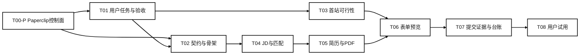

# 一期实施与验收任务台账

更新时间：2026-10-09；执行根目录：`/Users/tang/Documents/Bid_Analysis/CV_Agent`。

本文件将一期产品范围转成可交付任务。总架构和三期规划保持原定位；执行先验证一条纵向链路，后续扩大网站、岗位和用户规模。当前只有文档准备，不存在已运行的研发团队或已通过的产品测试。

## 1. 实施基线

| 项目 | 当前事实 | 对实施的影响 |
|---|---|---|
| 产品设计 | 已有总架构、三期文档、模块与接口草案 | 可用于范围基线，接口仍需要可校验的详细契约 |
| 实现与测试 | 目前未发现本工作区的实现代码和测试交付物 | 首轮不能跳过可行性、样例和运行入口 |
| 外部页面 | 首个招聘网站和读取范围尚未选择 | 真实网页登录与采集需有具体目标，本地样例处理可先进行 |
| 用户材料 | 本产品尚无用户确认的基础模板和事实版本 | 先使用合成或脱敏样例，不自动将父项目个人简历与业务资料灌入事实库 |
| AI服务 | 尚未为本产品确认模型、数据外发范围和预算 | 不擅自复用父项目凭据；可先用固定响应验证契约，不将其算作模型效果 |
| PDF编译 | 尚未完成本产品模板的编译验证 | 验证单文件模板和含图片/字体的 Overleaf 项目需求，不能默认两者等价 |
| Agent实例 | 本轮没有启动多个独立执行实例；中期已选 Paperclip 作为控制面 | 先验证本地控制面和任务交接，再使用它减少多 Agent 状态中转；报告必须区分作者自审与独立验收 |

## 2. 需要输入和可以先推进的工作

| 输入 | 谁提供 | 影响的任务及恢复条件 |
|---|---|---|
| 首个官网、招聘批次、目标岗位方向 | 用户 | T03开始真实页面验证；用户本人完成登录 |
| 基础简历文件、已确认事实及附件 | 用户确认已有材料的使用范围 | T05进入真实资料适配；不影响合成材料的流程验证 |
| 模型服务和必要资料的外发范围 | 用户结合实际需求决定 | T04/T05进入真实模型效果验证；本地固定响应仅用于接口和异常测试 |
| 一次真实提交的具体授权 | 用户在选定岗位与材料后操作 | T07完成外部结果验证；此前可验证预览、模拟结果和待核验状态 |

产品、架构和 QA 可以先明确输入输出、测试标签、事实保护和提交证据模型。首站验证与本地样例链路独立推进，到集成时再连接。

## 3. 执行任务与优先级

| 任务 | 负责人 / 独立验证 | 交付及通过条件 | 依赖 / 当前状态 |
|---|---|---|---|
| T00 工作区和文档基线 | 主理人 / 作者自审 | 工作路径、文档索引及当前未实现状态已记录 | 已完成文档盘点，不属于产品验收 |
| T00-P Paperclip 控制面验证 | 架构与主理人 / 独立 QA | 回环绑定、脱敏任务、负责人/状态交接、所有权冲突、停止/重启恢复和无外部模型运行；失败时保留本地任务卡回退 | P0；planned，依赖T00，不开放邮箱、招聘账号、验证码或真实提交 |
| T01 最小用户任务与验收基线 | 产品 / QA | 一份端到端用户任务、字段清单、错误恢复及 AC 编号；把假设和用户确认分开 | P0；draft，需确定首站及实际任务 |
| T02 数据契约和运行骨架 | 架构与实现 / QA | 用户事实、岗位、匹配、简历及任务的可校验样例；版本、错误、取消和去重约定；可运行最小入口 | P0；draft，先明确契约再写骨架 |
| T03 首个招聘官网可行性 | 浏览器实现 / QA | 记录页面读取方式、原文位置、登录失效和分页行为；给出支持范围和无法读取时的恢复路径 | P0；waiting_input，待首站，真实会话由用户建立 |
| T04 JD解析和匹配证据 | 服务实现 / QA | 规则区分满足、不满足、未知；每个能力判断关联 JD 原文和事实；在样例上输出可核对结果 | P0；draft，依赖T01/T02，真实模型另需外发范围 |
| T05 事实约束简历与PDF | 材料实现 / QA | 生成差异、来源和保护字段报告；编译成功、页数及版面核验；失败保留原稿，错误可追溯 | P0；draft，依赖T02/T04和确认的模板 |
| T06 表单预览和暂停恢复 | 浏览器实现 / QA | 选定站点字段映射、修改前预览、不确定字段提示、验证码暂停和恢复；能撤销未提交改动 | P0；draft，依赖T03/T05 |
| T07 提交证据与台账 | 服务与浏览器实现 / QA | 点击、网站结果和台账分开；失败不标已投递，重复状态事件不创建重复申请 | P0；draft，依赖T02/T06；真实提交另需用户操作 |
| T08 端到端试用与下一轮决定 | 运营 / 产品与QA | 同任务的手工基线、辅助耗时、人工修改、失败点和用户反馈；主理人依据报告确定扩展或返工 | P0；draft，依赖T04-T07独立通过 |

框架优先定义公共数据与错误契约，并先完成 T00-P 的本地控制面验证，不预先实现二、三期模块。三个投递模式先明确用户选择和排序规则，批量执行放在基础单岗位链路通过之后。真实网站、多用户云权限和规模化运行不因“总框架完成”自动获得验证。

## 4. 对应里程碑与执行路径

| 里程碑 | 用户能看到的产物 | 进入下一步的依据 |
|---|---|---|
| L0 可实现性明确 | 首站读取记录、事实/JD样例、契约和风险清单 | 能说明哪些能力已实测、哪些是假设，并有实际输入输出 |
| L0.5 协作控制面可用 | Paperclip 本地健康检查、脱敏任务交接、重启恢复和权限边界报告 | 多 Agent 通信可追踪；控制面失败时仍可用本地任务卡回退 |
| L1 内部链路可运行 | 导入脱敏 JD 后生成解释、定制简历和经核验的 PDF | 核心事实与未知条件正确，编译结果真实，独立 QA报告对应当前版本 |
| L2 浏览器链路可演示 | 指定站点采集岗位、打开申请页面、预览并填写确认的字段 | 验证码和不确定字段能暂停，失败/撤销可恢复 |
| L3 一次可信试用 | 用户选定申请、操作提交，系统保存结果证据或待核验状态 | 台账不误报成功，任务观察与原人工流程可比较 |
| L4 扩展决策 | 问题优先级、修复清单和下一站选择 | 扩展建立在证据上，二期、三期功能仍通过各自任务验收 |

首次 T03 完成后再估算各任务时长与成本。没有实际页面、模板和技术验证时，不承诺固定开发周期。每个任务开始时登记时间预算和一个可检查的中间结果，超过预算先记录原因和缩小实验。

## 5. 最小验证设计

| 验证对象 | 样例与检验方式 | 试点通过条件 |
|---|---|---|
| JD条件与匹配 | 暂定20份合成或经允许脱敏的 JD：正常匹配、硬性不符、缺字段、表达歧义和恶意页面文本各4份；QA另留5份挑战样例，人工标注要求与原文位置 | 所有硬性不符/未知案例正确分开；禁止按缺失猜测通过；能力关联有来源。一般质量报告分子/分母，具体门槛在T01/T04验证前固定 |
| 简历事实 | 合成资料含日期、公司、数字和禁止推断项，故意给出与 JD 不匹配的经历 | 当前样例中保护事实无错误，无法支撑的能力不写入；报告样例数，不能据此宣称总体零错误 |
| PDF与版面 | 单文件示例模板先验证；真实含图片、校徽、特殊字体的模板单独测试 | 有真实成功编译及页数和视觉检查证据，不能用模拟结果代替可投递 PDF |
| 浏览器字段 | 指定站点已观察字段集，加登录失效、字段歧义、页面刷新及验证暂停案例 | 关键字段无错误映射，不确定字段保留待确认；最终提交仍由用户执行 |
| 申请状态 | 模拟提交成功、失败、超时、跳转、重复事件；至少一次获授权的真实结果核验 | 无结果时只能待核验，明确失败不能记录已投递，事件重复不会重复创建台账 |
| Agent协作控制面 | 脱敏任务创建、状态更新、交接、同一写入范围冲突、停止/重启 | Paperclip只绑定本机；无外部模型和真实账号；控制面不可用时本地任务卡仍能继续 |
| 价值与成本 | 一次相同任务的人工流程和辅助流程；记录阅读、纠错、编译、填写及验证时间 | 完成质量不下降，是否节省时间以测量结果为准；一例只能证明可用性，不能推断全部用户收益 |

合成样例验证逻辑，真实站点验证兼容性，用户试用验证价值；三者分别报告，不合并成“产品全部通过”。

## 6. 真实投递状态口径

`ready_for_user_submit` 表示材料和表单准备完成，`awaiting_confirmation` 表示等待用户完成操作或验证，`submitted_pending_verification` 表示已报告点击但尚无网站结果，`submitted_verified` 表示有成功回执或用户在网站申请记录中的核验依据，`submission_failed` 表示明确失败。

“已投递”只用于有结果证据的记录。用户手动确认已投时注明 `verification_method=user_attested`，不能标成系统已核验。该口径细化一期台账，并用于原 `application.submitted` 事件契约；详见数据接口文档。

## 7. 每次交付的证据包

证据包放在 `outputs/verification/<TASK-ID>/<RUN-ID>/`，记录输入来源与版本、实现变更快照、契约版本、复跑命令或操作步骤、期望与实际结果、失败及覆盖空白、产物位置与审查结论。作者自测与独立 QA使用不同运行 ID。没有对应运行的状态保持未验证。

本轮台账和协作模板仅完成文件结构及规则的自审，未进行产品测试、网站访问、模型调用或真实投递。
