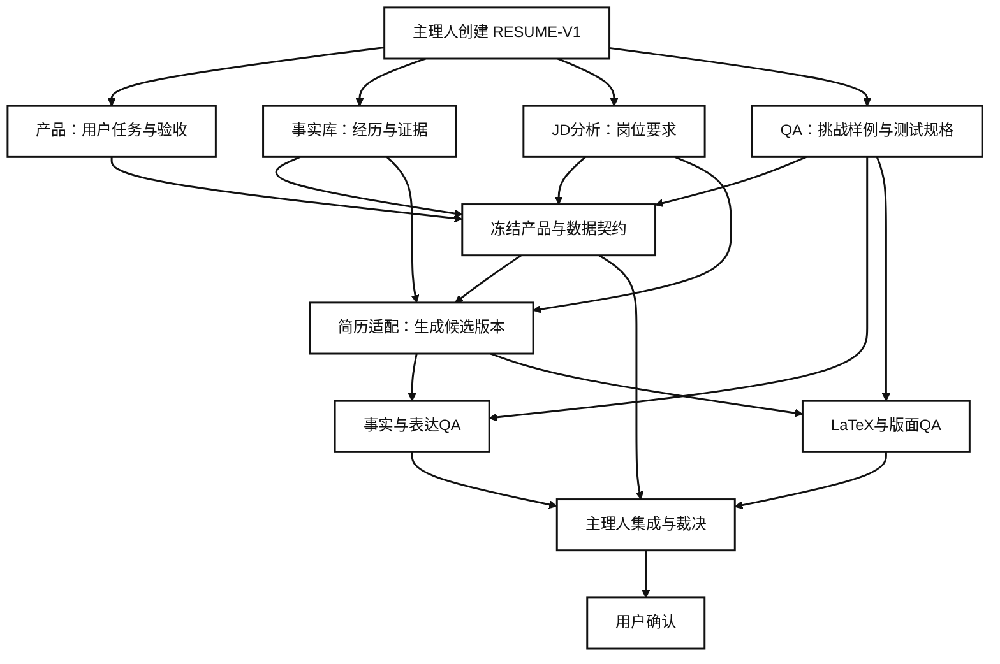

# 简历系统多 Agent 并行协作设计

版本：0.2；日期：2026-10-09；状态：执行基线；中期通信控制面选用 Paperclip。

## 1. 文档目的

本文把简历系统中的多 Agent 协作从角色设想转成可执行协议。它回答四个问题：哪些任务可以并行，Agent 如何通信，谁可以修改哪些文件，冲突如何由主理人裁决。

本文面向单一 GPT 模型下的多角色协作，也兼容后续拆成多个独立任务上下文。角色名称不代表必须使用不同模型；独立性来自任务边界、文件权限、版本化产物和独立验收。

## 2. 第一条真实链路

多 Agent 首先服务简历系统，不直接启动全量招聘网站和自动投递开发。第一条可验证链路是：

```text
已有基础简历和材料
→ 事实库 v1
→ 一个真实 JD 的结构化分析
→ 一份岗位定制简历提案
→ 事实与表达 QA
→ LaTeX 编译与版面 QA
→ 用户确认
```

岗位采集、网页填写、邮箱同步和公开内推信息属于后续任务。当前目标是证明“真实经历可以被稳定、可追溯地改写成可投递简历”。

## 3. 单 GPT 的两种运行模式

### 3.1 角色轮换模式

只有一个对话上下文时，GPT 依次切换角色。它不是实际并行，适合第一轮工作，因为上下文成本低，容易观察全过程。

```text
主理人 → 事实库 → JD分析 → 简历适配 → 事实QA → LaTeX QA → 主理人裁决
```

每次切换角色都要写明当前角色、读取的版本、允许写入的路径和输出格式。不能在同一轮中同时宣称“生成并独立通过”。

### 3.2 多任务并行模式

平台支持独立任务上下文时，由主理人创建多个子任务。子任务共享 `CV_Agent` 文件，但拥有不重叠的写入范围；通信通过任务卡和结构化产物完成。

```text
主理人
├── 产品验收任务
├── 事实库整理任务
├── JD解析任务
└── QA规格任务
        ↓ 契约冻结
简历适配任务
        ↓
事实QA任务 + LaTeX QA任务
        ↓
集成与裁决任务
```

如果平台无法创建独立上下文，采用角色轮换模式，并将 QA 标记为 `same-model-independent-pass`，不能称为外部独立审计。

### 3.3 Paperclip 控制面模式

进入中期后，主理人不再手动转发每个 Agent 的状态。Paperclip 负责创建任务、分配负责人、同步状态、保存评论和交接记录；Agent 仍通过固定任务卡和结果包提交结构化产物。Paperclip 是通信与治理入口，不是事实来源，也不是最终验收者。

```text
主理人创建任务
    ↓
Paperclip 分派与唤醒 Agent
    ↓
Agent 读取契约，在独立 Worktree 产出结果
    ↓
Paperclip 记录状态与交接，文件系统保存版本化产物
    ↓
独立 QA / 主理人裁决 / 用户确认
```

Paperclip 的任务评论必须携带 `task_id`、`artifact_version`、`contract_version`、`run_id`、`write_scope`、`evidence_refs` 和 `next_action`。如果任务涉及个人事实、账号会话、邮箱、验证码或真实提交，Paperclip 只能记录“等待用户授权/确认”，不能替用户完成授权。

## 4. Agent 角色与职责

| 角色 | 核心任务 | 可写范围 | 明确禁止 |
|---|---|---|---|
| 主理人 Agent | 创建任务、协调依赖、冻结契约、裁决争议、汇总状态 | `docs/workflow/tasks/`、决策和审查记录 | 替用户确认事实；绕过 QA；把自测标成独立验收 |
| 产品 Agent | 定义用户任务、流程、范围、验收标准和优先级 | `docs/workflow/contracts/`、产品提案 | 直接改代码或宣布代码通过 |
| 架构 Agent | 定义数据模型、接口、模块依赖和集成边界 | `docs/workflow/contracts/`、架构提案 | 在没有可行性证据时承诺网站兼容 |
| 事实库 Agent | 整理简历、项目材料和事实证据，标注保护字段 | `data/profile/`、事实报告 | 润色简历；修改用户事实；补造数字 |
| JD 分析 Agent | 解析职责、硬性条件、能力权重和匹配证据 | `data/jd_samples/`、JD报告 | 直接修改简历；把未知条件猜成满足 |
| 简历适配 Agent | 根据冻结的事实和 JD 生成岗位版本提案 | `outputs/proposals/`、指定的变体文件 | 覆盖基础简历；修改保护字段；自行验收 |
| 事实 QA Agent | 检查真实性、来源、日期、数字、ownership和夸大表达 | `docs/workflow/reviews/`、QA报告 | 修改被审简历；提出无证据的个人偏好 |
| LaTeX / 版面 QA Agent | 检查编译、页数、溢出、字体和可读性 | `outputs/verification/`、QA报告 | 判断经历真实性；覆盖源文件 |
| 运营迭代 Agent | 记录试用耗时、纠错、弃用点和用户反馈 | `docs/workflow/feedback/`、运营报告 | 用少量反馈直接改需求基线 |

上述角色可以由一个 GPT 顺序执行，也可以由多个任务上下文分别执行。角色记忆的具体内容保存在 [Agent 分工记忆](workflow/agent_memory.md)。

## 5. 并行任务图



产品、事实库、JD分析和 QA 规格可以并行，因为它们写入不同产物。简历适配必须等待事实和 JD 版本冻结；QA 必须等待候选版本生成；用户确认必须等待所有相关 QA 完成。

## 6. 文件写入隔离

每个任务启动前登记 `read_scope` 和 `write_scope`。读取范围可以重叠，写入范围不能重叠。

| 文件区域 | 默认写入者 | 其他角色的处理方式 |
|---|---|---|
| `docs/` 产品契约 | 产品 Agent、架构 Agent | 提交提案，由主理人集成 |
| `data/profile/` 事实库 | 事实库 Agent | 只能提出事实冲突，不能直接覆盖 |
| `data/jd_samples/` JD样例 | JD分析 Agent | QA可以读取并提交标注差异 |
| `outputs/proposals/` 候选版本 | 简历适配 Agent | QA只读审查，主理人选择版本 |
| `outputs/resumes/` 已确认版本 | 集成 Agent | 用户确认后生成，不由普通 Agent直接覆盖 |
| `tests/` 测试 | 实现 Agent或指定 QA Agent | 另一个角色写入独立测试文件，避免同文件冲突 |
| `outputs/verification/` 验证证据 | QA Agent | 只追加新的运行记录，不覆盖旧报告 |

同一文件出现两个写入请求时，后一个任务自动进入 `waiting_conflict`，由 Paperclip 记录冲突并通知主理人；主理人决定合并顺序，Agent不能自行覆盖前一个结果。Paperclip 的任务锁不能替代 Git Worktree 和文件级写入范围。

## 7. Agent 通信协议

Agent 不依赖聊天上下文传递结论，而使用 Paperclip 任务状态、任务评论、任务卡和结果包。Paperclip 负责传递“谁在做、做到哪、下一步是谁”；文件系统负责保存“改了什么、依据是什么、如何验证”。

### 7.1 任务卡

```yaml
task_id: JD-001
parent_task: RESUME-V1
agent_id: jd-analysis-agent
objective: 解析指定AI产品岗位的职责与能力要求
input_versions:
  profile: evidence_v1
  jd: jd_ai_product_001
read_scope:
  - data/profile/evidence_v1.yaml
  - data/jd_samples/jd_ai_product_001.txt
write_scope:
  - outputs/artifacts/JD-001/
acceptance_ids:
  - JD-AC-001
status: ready
```

### 7.2 结果包

```yaml
task_id: JD-001
status: completed
artifact_version: jd_analysis_v1
artifacts:
  - outputs/artifacts/JD-001/jd_analysis.json
  - outputs/artifacts/JD-001/jd_analysis_report.md
evidence_refs:
  - jd_line_12_to_19
risks:
  - 生产环境经验未在JD中明确要求
unresolved_questions:
  - 是否需要突出海外方向
next_action: resume-adaptation-agent
requires_user_confirmation: false
```

结果包必须包含输入版本、输出产物、证据、风险、未解决问题和下一步负责人。没有这些字段的自然语言摘要不能作为集成依据。

## 8. 修改与合并流程

简历适配 Agent 不直接覆盖基础简历，而是生成变更提案：

```diff
- 参与“信源采集-字段映射-规则判断”Workflow
+ 参与设计“信源采集-字段映射-规则判断-证据归因-人工复核”Agent Workflow
```

每项变更附带：

```yaml
change_id: CHANGE-001
source_fact: baidu_acg_2026.fact_004
jd_requirement: agent_workflow
protected_fields_changed: false
requires_user_confirmation: false
```

合并顺序固定为：

```text
事实库冻结
→ JD分析冻结
→ 简历适配提案
→ 事实与表达QA
→ LaTeX与版面QA
→ 主理人集成
→ 用户确认
```

基础简历始终保留。建议版本命名为：

```text
resume_base_v1.tex
resume_ai_product_proposed_v1.tex
resume_ai_product_verified_v1.tex
resume_ai_product_approved_v1.tex
```

## 9. 冲突与裁决

| 冲突类型 | 例子 | 判断依据 | 裁决者 |
|---|---|---|---|
| 事实冲突 | “参与”是否可以改为“负责” | 用户确认材料和事实来源 | 用户，必要时主理人暂停 |
| 需求冲突 | 百度经历和GEE-Agent哪个优先 | 目标JD与用户投递方向 | 产品 Agent提出，用户确认最终方向 |
| 技术冲突 | YAML还是SQLite | 当前阶段数据规模、查询和维护成本 | 架构 Agent提出，主理人记录ADR |
| 质量冲突 | QA认为表达夸大，作者认为只是润色 | 保护字段、来源和验收标准 | 事实QA先阻塞，主理人裁决 |
| 范围冲突 | QA要求提前接入Outlook | 当前阶段范围和风险 | 主理人记录为下一期需求 |
| 权限冲突 | Agent需要读取手机号或登录会话 | 最小权限和用户明确授权 | 用户决定，主理人不得代替授权 |

主理人裁决顺序为：用户确认事实、已接受的 PRD、冻结的接口契约、可复现证据、阶段范围和成本。涉及个人事实、登录状态、邮箱权限或真实提交时，用户拥有最终决定权。

## 10. 独立 QA 规则

独立 QA 应读取最终候选产物、冻结的需求和测试样例，不读取简历适配 Agent的解释过程。QA必须输出：

```text
审查版本
运行编号
测试输入
预期结果
实际结果
问题等级
证据位置
修复建议
剩余风险
```

如果同一个 GPT 在同一个上下文中完成生成和审查，结果标记为 `same-model-independent-pass`，不写成外部独立审计。独立性来自不同任务上下文、固定版本、独立挑战样例和不可直接修改被审文件。

## 11. 简历系统第一轮并行任务

| 任务 | 角色 | 可以并行 | 主要交付 |
|---|---|---:|---|
| RES-PRODUCT-001 | 产品 Agent | 是 | 用户任务、验收标准和版本范围 |
| RES-EVIDENCE-001 | 事实库 Agent | 是 | `evidence_v1`和保护字段清单 |
| RES-JD-001 | JD分析 Agent | 是 | JD结构化要求和匹配权重 |
| RES-QA-001 | QA规格 Agent | 是 | 挑战样例和事实一致性测试 |
| RES-ADAPT-001 | 简历适配 Agent | 否，等待上面四项 | 岗位定制简历提案 |
| RES-FACT-QA-001 | 事实QA Agent | 否 | 事实、表达和ownership审查 |
| RES-LATEX-QA-001 | LaTeX QA Agent | 可与事实QA并行 | PDF、编译和版面报告 |
| RES-INTEGRATE-001 | 主理人/集成 Agent | 否 | 集成版本和裁决记录 |

## 12. 完成标准

简历系统第一条链路只有同时满足以下条件，才标记为 `accepted`：

| 条件 | 证明方式 |
|---|---|
| 用户事实已确认 | 事实库版本和来源记录 |
| JD已结构化 | JD报告和原文位置 |
| 每个改写有证据 | 变更提案中的 `source_fact` |
| 没有保护字段错误 | 独立事实QA报告 |
| LaTeX编译成功 | 编译日志和PDF |
| PDF版面可读 | 版面QA报告 |
| 用户确认最终文本 | 用户确认记录 |

任何一个条件缺失，都只能使用 `draft`、`changes_requested`、`waiting_input` 或 `coverage_incomplete`，不能写成已完成。

## 13. 当前执行建议

第一轮启动四个可并行任务：产品验收、事实库、JD分析和 QA 规格。它们完成后冻结契约，再启动简历适配；事实QA和LaTeX QA可以并行审查候选版本，最后由主理人集成并交用户确认。

具体角色记忆、读写边界和启动前检查见 [Agent 分工记忆](workflow/agent_memory.md)。
