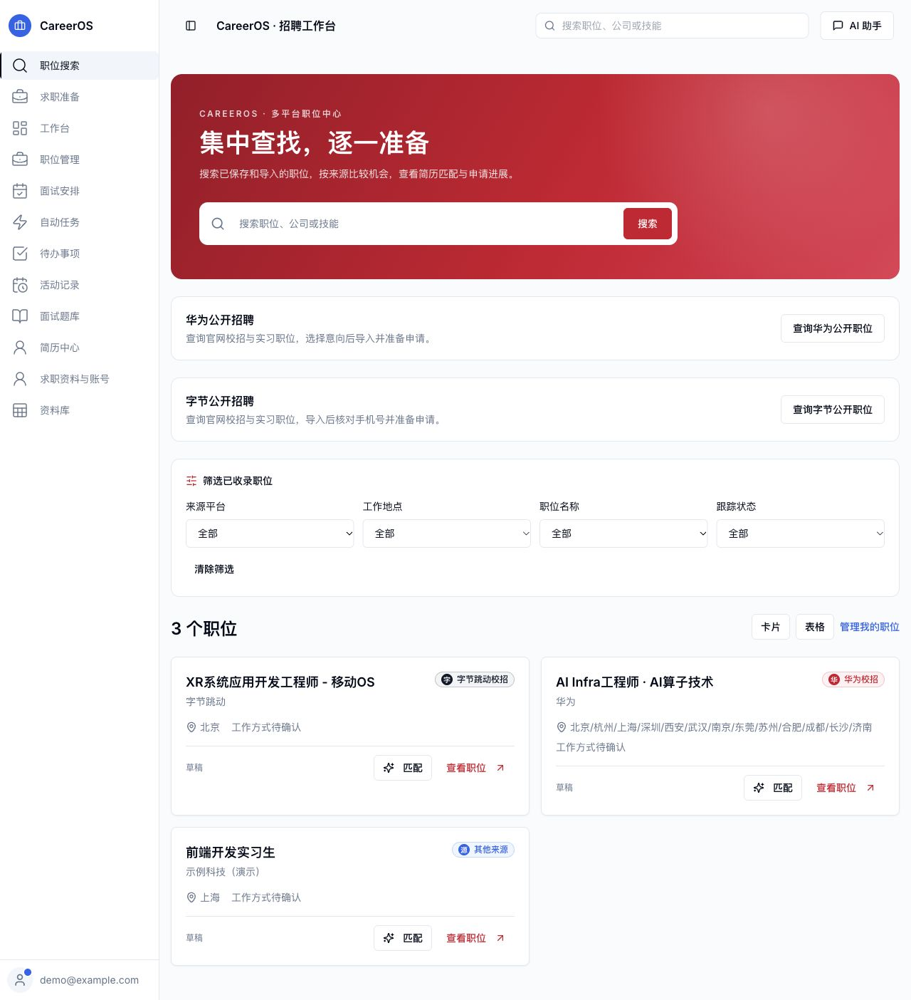
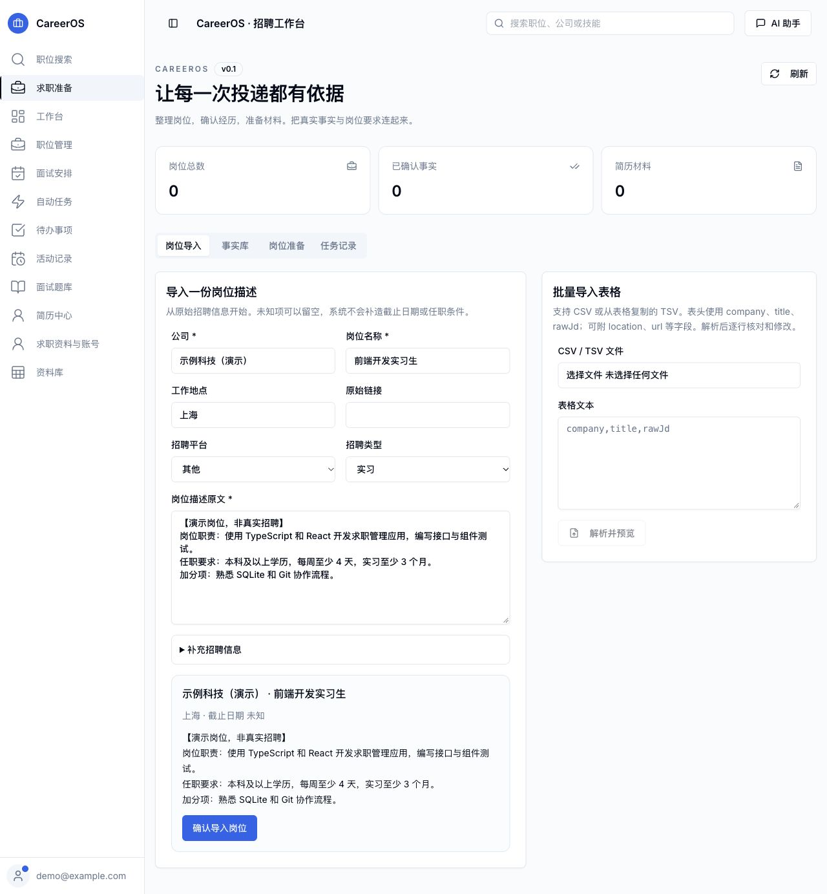
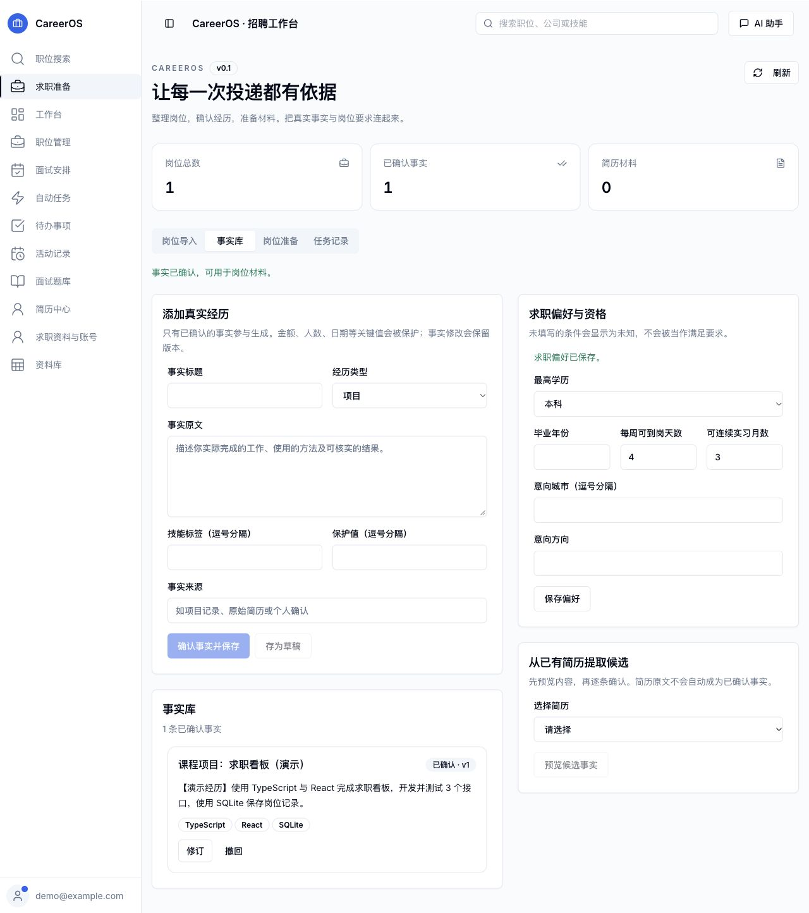
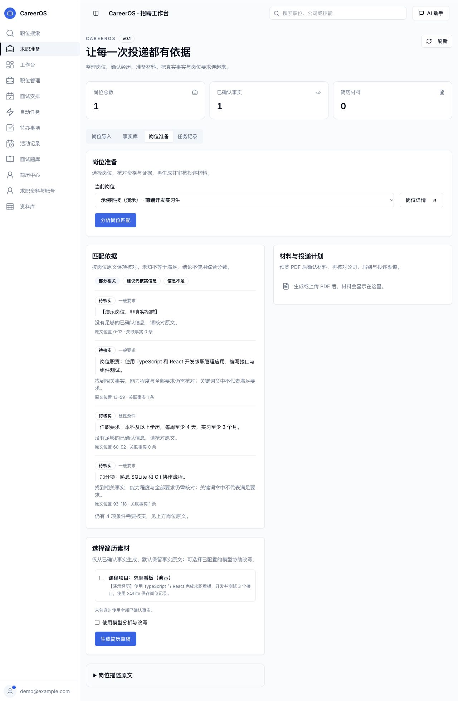
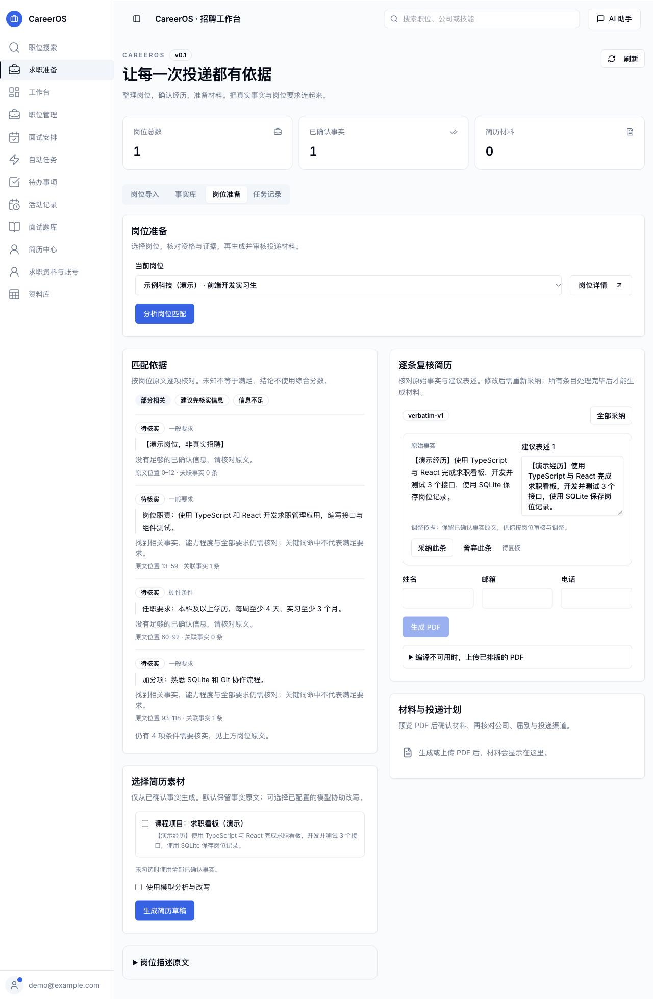
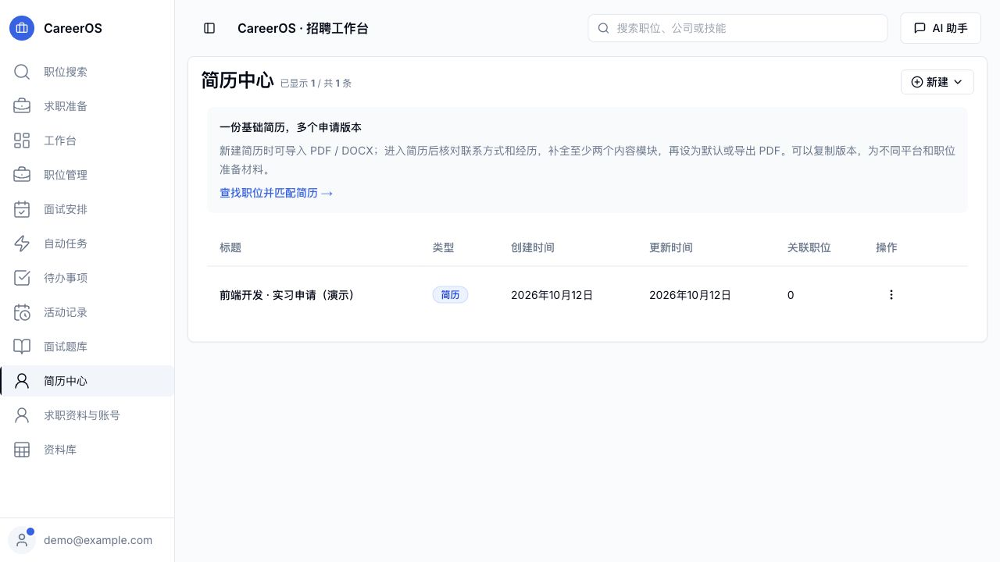
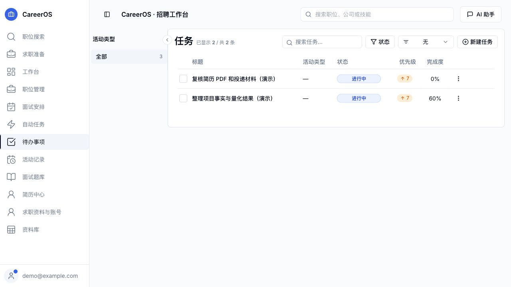
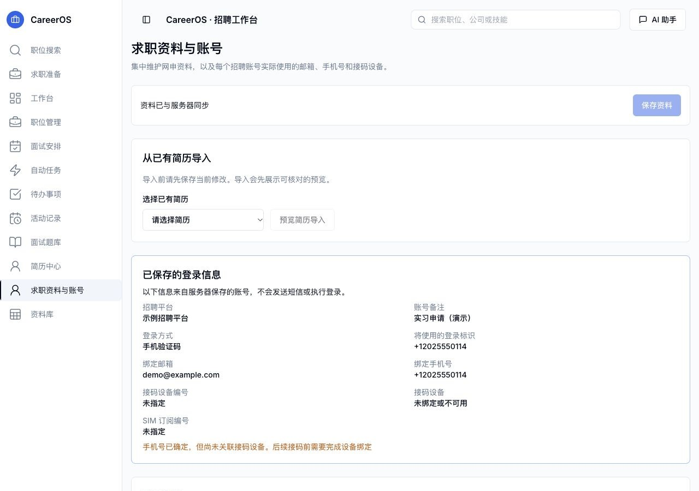

# CareerOS

**把岗位、真实经历、简历材料和申请进度放在同一个求职工作台。**

CareerOS 是基于 JobSync 定制的自托管求职管理工具，面向中文求职场景。你可以收录岗位描述，整理并确认自己的经历，逐项核对岗位要求，审核简历草稿，再跟踪投递、面试和待办事项。

开发与更新维护在本仓库的 **`charles` 分支**。

[功能概览](#功能概览) · [界面与流程](#界面与流程) · [快速启动](#快速启动) · [本地开发](#本地开发) · [手机伴侣](#手机伴侣) · [当前边界](#当前边界)



> 截图采集于 2026-10-12，来自本机实际运行版本的隔离演示环境。公司、岗位、简历、邮箱、号码和任务均为演示数据，不代表真实招聘信息或个人履历。截图中侧栏的「求职资料与账号」是本地预览功能，状态见下文；其他截图未使用设计稿或合成界面。

## 功能概览

| 模块 | 现在可以做什么 | 使用条件与范围 |
| --- | --- | --- |
| 职位搜索 | 搜索职位、公司与技能，按来源、地点、名称和状态筛选，切换卡片与表格 | 检索已保存、已导入的岗位 |
| 岗位导入 | 粘贴 JD，或导入 CSV / TSV；预览、修改后确认入库 | 保留原始描述；未提供的信息保留未知 |
| 事实库 | 整理项目、实习、教育与技能；从已有简历提取候选；确认、修订或撤回事实 | 候选需要人工确认，修订保留版本 |
| 岗位准备 | 关联岗位要求与已确认事实，展示匹配依据、硬性条件和待核实项 | 关键词相关不等于满足全部要求 |
| 材料审核 | 生成草稿，逐条采纳或舍弃，生成中文 PDF，预览并确认材料 | 模型改写可选；中文 PDF 编译需要 LaTeX 服务 |
| 简历中心 | 管理多个简历版本，编辑内容，复制、导入和导出 PDF | PDF / DOCX 结构化导入需要配置 AI |
| 投递与面试 | 跟踪岗位状态、阶段历史、面试与实际投递记录 | 外部投递结果需要本人核对并记录 |
| 待办与活动 | 设置任务状态、优先级和完成度，关联活动并记录投入时间 | 用于跟进个人求职安排 |
| 资料库与题库 | 管理公司、联系人、面试问题及答案 | 支持关联岗位和复用准备内容 |
| 自动任务 | 配置 Greenhouse、Lever、Ashby 公司岗位发现与候选审核 | 需要配置来源、目标和模型；不覆盖全部招聘网站 |
| AI 助手 | 对话式简历评审、岗位匹配、求职信和岗位录入 | 先在设置中选择模型；写入操作有确认步骤 |
| 数据与扩展 | 导出 / 导入备份；可选 MCP；Android 手机伴侣与 Phone Bridge | CareerOS 部署配置默认关闭 MCP，手机端需单独配对 |

## 界面与流程

### 1. 从岗位原文开始

在「求职准备 → 岗位导入」填写公司、岗位与 JD，核对预览后入库。表格导入至少需要 `company`、`title`、`rawJd` 三列，支持 CSV 文件或粘贴 TSV 文本。



### 2. 把经历整理为可核对的事实

在事实库记录实际做过的工作、使用的方法和可核实的结果。金额、人数、日期等关键值可设为保护值。已有简历可以提供候选内容，确认后才参与材料生成。



### 3. 核对要求，再审核简历

选择岗位后运行匹配，逐项查看岗位原文、关联事实与仍需核实的条件。默认草稿保留事实原文；开启模型后可辅助分析与改写，但仍要逐条审核。

截图中的「待核实」是实际运行结果。系统不会仅因为技能词命中，就把全部任职条件判为满足。

<details>
<summary>查看岗位匹配截图</summary>



</details>

<details>
<summary>查看逐条复核截图</summary>



</details>

完成条目审核后，填写联系方式并生成 PDF；编译不可用时也可上传已排版的 PDF。预览并确认材料后，再核对公司、届别与渠道、生成投递计划。实际提交仍由本人完成。

### 4. 管理简历版本与下一步行动

简历中心保存不同申请方向的版本，待办事项管理材料复核、项目梳理等具体工作。岗位管理与面试安排继续承接申请后的跟进。





### 5. 求职资料与账号（本地预览）

**截至本次文档更新，这一功能已在本机运行，但对应源码与数据库迁移尚未提交到本分支。下面展示的是本地预览，克隆当前分支不会获得此页面。**

页面集中维护基本资料、教育、工作与实习、项目、技能、证书、获奖、求职意向与平台补充字段，并支持从已有简历预览导入。

账号按以下关系明确绑定：

```text
招聘平台账号 → 登录方式 → 绑定邮箱 / 绑定手机号 → 接码设备 / SIM
```

同一平台可记录多个账号；邮箱与号码由本人选择并核对，系统不会根据旧测试记录猜测。登录预览显示该账号将使用的具体标识。设备尚未绑定时会提示补齐，页面本身不保存密码、不发送短信、不执行登录。



## 快速启动

推荐使用仓库内的 [CareerOS Compose 配置](docker-compose.career.yml)，它同时启动网站和中文简历编译服务。需要 Git、Docker 与 Docker Compose，以及用于生成随机密钥的 OpenSSL。

```sh
git clone --branch charles --single-branch git@github.com:jimmyoyang/careerOS.git
cd careerOS
```

首次部署生成 `.env`。下面的命令只创建新文件；已有 `.env` 时会拒绝覆盖。若文件已存在，请在原文件中补充缺少的变量，保留原有密钥。

```sh
(
  umask 077
  set -C
  printf 'AUTH_SECRET=%s\nENCRYPTION_KEY=%s\n' \
    "$(openssl rand -base64 32)" \
    "$(openssl rand -base64 32)" > .env
)
docker compose -f docker-compose.career.yml up -d --build
```

首次构建需要下载依赖与中文排版组件。完成后访问 **http://localhost:3737**，注册本实例账号。

```sh
# 查看服务状态和网站日志
docker compose -f docker-compose.career.yml ps
docker compose -f docker-compose.career.yml logs --tail=100 app

# 停止服务，保留数据卷
docker compose -f docker-compose.career.yml down
```

网站默认只监听本机 `127.0.0.1:3737`，数据库与上传文件保存在 `career-data` 命名卷中。更新前先导出备份，并保留部署使用的 `.env`。更新代码后重新执行 `up -d --build`；数据库迁移由容器启动脚本执行。不要用 `down -v` 停止日常服务，它会删除数据卷。

### 配置说明

| 变量 | 用途 |
| --- | --- |
| `AUTH_SECRET` | 登录会话密钥，应持久保存 |
| `ENCRYPTION_KEY` | 加密已保存的模型 API Key，切勿随意更换 |
| `DATABASE_URL` | SQLite 路径；Compose 内设为 `file:/data/career.db` |
| `UPLOADS_DIR` | 上传与材料文件目录；Compose 内为 `/data` |
| `NEXTAUTH_URL` | 实际访问地址，默认 `http://localhost:3737` |
| `AUTH_TRUST_HOST` | CareerOS 本机部署配置为 `true` |
| `CAREER_ENABLED` | 启用求职准备工作台，CareerOS Compose 已开启 |
| `CAREER_LATEX_URL` | 中文 PDF 编译服务地址，Compose 内为 `http://latex:3738` |
| `MCP_ENABLED` | CareerOS Compose 默认 `false`，按需开启 |
| `TZ` | CareerOS Compose 使用 `Asia/Shanghai` |

除两个密钥外，上表中的值已写在 Compose 配置内；修改这些部署选项时请同步调整 Compose，而非仅在 `.env` 中添加同名变量。

AI 功能可连接 Ollama，或在设置中配置 OpenAI、DeepSeek、OpenRouter、Google Gemini。模型能力会影响导入、工具调用与生成效果。云端模型会接收相关简历或岗位内容；选择本地模型时也应核对实际配置的服务地址。

## 本地开发

仓库声明 **Node.js 24 或更高版本**，使用 npm、Next.js、React、TypeScript、Prisma 和 SQLite。

先安装依赖并生成数据库客户端：

```sh
npm ci
npx prisma generate
```

准备开发用 `.env`，在已有密钥之外补充以下配置。相对 SQLite 路径按 Prisma schema 所在目录解析，对应 `prisma/dev.db`。

```dotenv
DATABASE_URL=file:./dev.db
NEXTAUTH_URL=http://localhost:3737
AUTH_TRUST_HOST=true
CAREER_ENABLED=true
CAREER_LATEX_URL=http://127.0.0.1:3738
MCP_ENABLED=false
TZ=Asia/Shanghai
```

```sh
touch prisma/dev.db
npx prisma migrate deploy
npm run dev
```

开发网站默认使用 3737 端口；若本机已部署生产实例，请先处理端口占用，或使用 `npx next dev --turbopack -p 3740` 并同步修改 `NEXTAUTH_URL`。开发库与生产库应使用不同路径。

中文 PDF 编译需要单独启动服务，并确保 `xelatex` 和中文字体可用。macOS 安装相应 TeX 环境后可运行：

```sh
XELATEX_BIN=/Library/TeX/texbin/xelatex node services/latex/server.mjs
```

### macOS 本机常驻部署

[scripts/deploy-career.mjs](scripts/deploy-career.mjs) 提供构建产物部署、LaunchAgent 管理和代码版本回退。它使用 `~/Library/Application Support/CareerOS` 保存运行配置、数据、备份与版本目录；中文编译依赖本机 TeX 环境。

```sh
npm run build
node scripts/deploy-career.mjs deploy

# 回退到上一个代码版本
node scripts/deploy-career.mjs rollback

# 停止本机服务，保留数据
node scripts/deploy-career.mjs stop
```

部署会在迁移前备份数据库；`rollback` 切换代码版本，**不会自动还原数据库**。涉及数据结构变化时，应结合备份处理兼容性。

## 手机伴侣

[android](android) 与 [services/phone-bridge](services/phone-bridge) 提供独立的 Android 手机伴侣和电脑桥接服务。它们用于配对设备与处理授权的短信验证码流程，需要单独安装、配对和验证。

构建脚本需要 JDK 17、Android SDK，以及 `35.0.0` 版本的 Android Build Tools；先设置好 `JAVA_HOME` 与 `ANDROID_HOME`：

```sh
npm run phone:build
npm run phone:bridge -- status
npm run phone:test
```

初始化桥接时使用电脑实际的局域网 IP。将下列示例 IP 替换后执行：

```sh
npm run phone:bridge -- setup 192.168.1.10
npm run phone:bridge -- start
npm run phone:bridge -- open
```

管理端只监听本机，手机通过 TLS 与电脑连接。配对信息、令牌、二维码及真实短信不应放进仓库或 README 截图。设备接码与招聘平台岗位同步是独立能力，完成短信登录不代表已采集该平台全部岗位。

## 当前边界

- **华为岗位不是全量同步。** 选择华为平台或筛选华为来源，只能展示已经收录的记录。当前没有可据此承诺的华为全岗位同步流程。
- **外部投递需要本人完成。** 本项目支持准备材料、投递计划和记录，不承诺自动填写并提交所有招聘网站。
- **匹配需要核实。** 信息缺失会显示未知或待核实；模型结论与关键词命中都不能替代岗位原文和真实经历。
- **AI 与中文 PDF 有独立依赖。** 模型未配置时仍可整理岗位与事实；模型导入、评审及改写需要服务可用，中文 PDF 编译需要 LaTeX。
- **本地预览与已提交功能有区别。** 求职资料、账号与设备绑定页面的截图展示本机进展，本次文档提交不包含该模块源码。
- **备份包含个人求职数据。** 数据导出不等同于完整运行环境备份，密钥与部署配置需另行妥善保存。

## 仓库结构与验证

```text
src/app/dashboard/       页面与路由
src/components/career/   岗位导入、事实库、材料审核界面
src/lib/career/          求职准备的数据与流程逻辑
src/actions/             服务端操作
prisma/                  数据模型与迁移
services/latex/          中文简历编译服务
services/phone-bridge/   手机桥接服务
android/                 Android 手机伴侣
scripts/                 部署、构建与设备检查脚本
__tests__/               单元与组件测试
e2e/                     浏览器端到端测试
screenshots/careeros/    本 README 的实际界面截图
```

项目提供以下检查命令。修改代码时按影响范围执行；运行命令列表本身不代表所有功能已经通过验收。

```sh
npm run lint
npm test
npm run build
npm run test:e2e
npm run phone:test
```

## 许可与致谢

CareerOS 基于 **JobSync（Gsync/jobsync）** 开发，保留其求职管理基础能力，并增加中文界面、证据驱动的求职准备、本机部署与手机协作相关实现。感谢上游项目及贡献者。

项目采用 [MIT License](LICENSE)，保留原有版权声明。仓库中的部分包名、历史脚本和实现标识仍使用 `jobsync`，不影响本文使用的项目名称 CareerOS。
